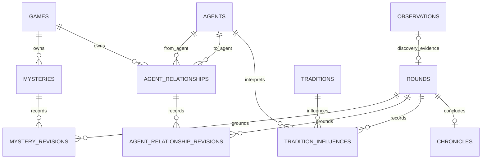
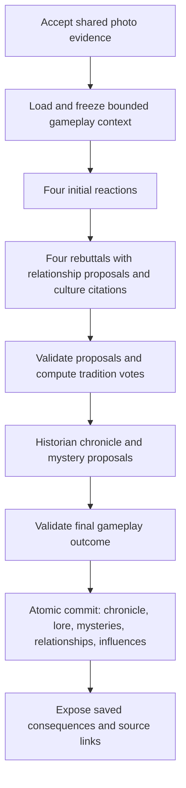

# Mythborn: Gameplay evolution implementation plan

Status: implementation added to the working tree. Migrations have been verified in a disposable database; application database migration and deployment are separate release steps. The design and acceptance gates below remain the reference for ongoing evaluation.

Scope: ongoing mysteries, evolving agent relationships, and traditions that influence later discoveries. This extends [FUNCTIONAL_SPEC.md](./FUNCTIONAL_SPEC.md), [DATABASE_DESIGN.md](./DATABASE_DESIGN.md), and [ARCHITECTURE.md](./ARCHITECTURE.md); it does not silently replace their existing rules. Reconcile those documents and [api/openapi.yaml](./api/openapi.yaml) when implementing each contract.

## 1. Intended experience

A discovery should change how the civilization approaches its next discovery. The player should be able to follow a question across photographs, notice one character reconsidering another's judgment, and see a shared practice influence later arguments.

An example sequence, not a scripted outcome:

1. A moss-covered stone produces two explanations: sacred markings and damp conditions. The historian records an open question with an observable comparison to investigate.
2. Three agents adopt a symbolic practice of studying marked stones. The Soldier remains skeptical of the explanation while supporting the precaution or practice.
3. A photograph of a dry, unmarked stone adds a comparison. Agents explicitly connect it to the question and practice. The Soldier may become more trusting of the Scientist's careful reasoning.
4. A later photograph complicates the explanation. The mystery can remain open or reopen; the practice may survive even if its original explanation loses support.

The result is a connected history, not a required success path. No hypothesis becomes a proven real-world fact merely because the agents vote for it.

## 2. Rules we preserve

- Tiger Cloud holds application data. Supabase remains Auth and private image storage.
- Each game's player role is fixed. Observer supplies photos and watches; no messages, votes, instructions, or debate participation are introduced for Observer.
- God proclamations and Messenger testimony/conversations retain their existing permissions. This phase does not add new role powers or player credibility mechanics.
- Any acceptable photo can start a discovery. Following a mystery is optional and unrelated photos remain valid.
- A discovery still has four reactions and one rebuttal per agent. Unresolved disagreement completes normally; no extra debate loop or player approval is added.
- The historian records the interpretation outcome. Deterministic code retains the existing tradition thresholds: three or four supporters adopt, one or two contest a new idea, and existing traditions follow the current retirement rule.
- Save concise final state and meaningful revisions, not permanent reactions, rebuttals, or chat transcripts. No numeric belief confidence, friendship points, resource economy, or simulated construction is added.
- Chronicle and gameplay changes commit together. Failure, abandonment, or repeated delivery cannot partially change the civilization.
- Preserve the illustrated artwork, medieval typography, themes, and current layouts. Add focused components; no visual redesign.

## 3. What the code already provides

| Existing implementation | Extension point |
|---|---|
| `internal/workflow/contracts.go`: round context, reactions, rebuttals, historian result, atomic commit payload | Add bounded gameplay context and proposed changes without expanding permanent debate storage |
| `internal/activities/activities.go`: character generation and historian calls | Extend the existing JSON outputs; validate supplied IDs, source attribution, and bounded reasons |
| `internal/activities/prompt.go`: at most 12 recent active traditions, five memories | Replace recency-only culture selection with a relevant, bounded context |
| `internal/retrieval/**`, `internal/repository/search.go`: game-scoped memory retrieval | Reuse committed evidence and chronicles; directly load small gameplay ledgers |
| `internal/workflows/coordinator.go`: phase checkpoints, evidence fingerprints, retries, final commit | Freeze new context, carry it across retries, version Temporal behavior |
| `internal/workflows/traditions.go`: deterministic tradition voting | Preserve adoption rules independently of narrative influence |
| `internal/repository/worker.go`: transactional finalization and council eligibility | Apply new revisions inside the same finalization transaction |
| `internal/repository/round_changes.go`: saved consequences | Expose new consequence types with source links |
| `web/src/app.tsx`, `web/src/pages/episode.tsx`: overview, agents, culture, rounds | Add mysteries, relationship details, and culture continuity using existing visual components |

Traditions already enter prompts. The missing part is relevant selection, an explicit connection to future reasoning, and a saved explanation of that influence. Relationships and mysteries need new durable state.

## 4. Ongoing mysteries

### Gameplay behavior

A mystery is a specific unanswered question grounded in recorded evidence. It is distinct from a chronicle outcome: a majority interpretation may still leave a useful question, and an unresolved verdict need not create a mystery if there is no observable way to investigate it.

The historian may propose at most one new mystery per discovery. Its record contains:

- A short title and question.
- Up to three competing explanations, with stable local keys and attributed agent positions.
- A concise account of evidence considered so far.
- One optional, safe observation that could distinguish explanations.
- State: `open` or `resolved`; a resolved mystery may reopen.
- Origin round, most recent revision round, and version.

“Resolved” means the civilization recorded a reasoned resolution. The record must retain uncertainty and dissent rather than claiming scientific proof. Resolution is independent of tradition votes.

Only discovery rounds create or revise mysteries in the first release. Councils and Messenger exchanges can refer to them, but do not directly mutate this ledger yet. This avoids adding another mutation path before photo-driven continuity works.

### Connecting later photos

After the shared photo description is accepted, load relevant open mysteries and, when the description matches, previously resolved ones. Give all agents the same question records and source references.

The historian explicitly proposes whether the new evidence advances an existing question, complicates it, resolves it, or reopens it. Mere similarity is not an evidence update. An unrelated photo leaves the mystery untouched.

The player can open a mystery and use the normal photo flow. Viewing that question does not send a hidden instruction to agents: linkage is established from the photo evidence and debate. Observer remains an evidence provider.

### Keeping the ledger useful

Proposed initial limit: three open mysteries per civilization. Once full, update an existing relevant question or record other disagreement only in the chronicle. Do not automatically resolve or discard an old mystery to make room.

Deduplicate within a round and against existing questions. Supply existing IDs to the historian and prefer updates. Use deterministic normalized-question comparison for exact duplicates; evaluate near-duplicate handling with fixtures rather than relying on an untested similarity threshold.

### UI

- Overview: a compact “Open questions” section, linking to each mystery.
- Mystery detail: question, explanations, agent positions, chronological evidence links, and optional next observation.
- Episode: “This discovery revisited…” plus the exact saved change.
- Archives: all mystery records and revisions remain readable, including unresolved questions.

## 5. Evolving agent relationships

### Gameplay behavior

Relationships are directed. The Soldier trusting the Scientist does not imply the Scientist trusts the Soldier. With four agents there are twelve possible directed pairs.

Use two qualitative dimensions:

| Dimension | Proposed states | Meaning |
|---|---|---|
| Trust in judgment | `cautious`, `neutral`, `trusting` | How the agent regards the other's reasoning |
| Rapport | `tense`, `neutral`, `warm` | Their interpersonal tone |

Agents can disagree while respecting one another. Agreement alone must not create trust, and skepticism must not become personal hostility automatically. These dimensions affect tone and willingness to consider an argument, never deterministic voting weights or an override of evidence.

Existing and new games begin neutral, with an empty relationship summary. Do not invent friendship, rivalry, or historical incidents during migration.

### When a relationship changes

An agent may propose up to two directed relationship updates in its rebuttal. It can revise only its own view of another agent. A proposal requires an actual reason grounded in a specific reaction or rebuttal context, or supplied committed history: conceding a point, recognizing a useful distinction, or repeating a previously documented mistake.

The historian narrates validated changes; it does not invent private feelings for other agents. No change is required. One meaningful revision per directed pair per round is allowed; identical state and summary produce no revision.

Discovery and council rebuttals may change relationships. Messenger exchanges continue to change only the recipient's existing allowed belief/conversation state in this release; a player's claim about another agent is not enough to modify a relationship.

### Memory and UI

Each agent receives its three outgoing relationship summaries and enough cited history to explain them. Public reaction text expresses the effect naturally rather than reciting enum labels.

Agent detail shows “How this agent views the others,” state labels, a short reason, and the source discovery/council. Episode consequences show changes after commitment. Avoid a graph dashboard initially: three readable entries communicate the state better on a phone.

## 6. Traditions that influence future discoveries

### Gameplay behavior

Separate three different things:

1. **Influence:** an existing tradition shaped an interpretation, concern, or suggested observation.
2. **Reconsideration:** agents explicitly raised an existing tradition as a candidate and voted on it.
3. **Revision:** the resulting support or tradition state changed and was committed.

Influence does not automatically trigger a vote or a revision. The Soldier can cite a taboo while opposing it; merely mentioning it does not count as support.

Select relevant adopted and contested traditions, with a small allowance for a retired tradition whose actual history matches the new evidence. An unrelated retired tradition should stay out of context. The current helper excludes every retired tradition, so this needs an explicit replacement.

Traditions may shape what agents notice, how they interpret it, what they disagree about, and the historian's optional suggestion. They do not cause fabricated festivals, settlement changes, weather, injuries, or other unobserved events. A proposed ritual is still a cultural practice, not proof it was physically performed.

### Structured influence records

Each agent may cite up to two supplied traditions per phase, with a concise influence category (`interpretation`, `precaution`, `challenge`, or `suggestion`) and explanation. The historian consolidates these into at most four durable influence summaries per round, retaining distinct positions where meaningful.

Persist only summaries that explain a consequence or substantive continuity. Validate that each tradition was supplied, each agent belongs to this game, and the cited behavior occurred in the current contributions. Do not store duplicate decorative mentions.

For a newly adopted tradition, its adoption belongs to this round; its influence on a later discovery starts in a later round. Record the tradition version/state used, so an old influence remains understandable after retirement.

### UI

- Episode: “Culture carried into this discovery,” clearly separated from adopted/contested/retired changes.
- Culture detail: current supporters, state revisions, and recent discoveries it influenced.
- Show supporter names rather than only a count.
- Suggestions may connect to a mystery or tradition, but remain optional and never prescribe a required outcome.

## 7. Proposed persistence model

Five new tables in Tiger Cloud. Keep typed queryable fields relational; use bounded JSON only for small explanation/position snapshots that are always read together. Do not hide this state in chronicle metadata.

| Table | Main fields and purpose |
|---|---|
| `mysteries` | UUID, game, title, question, state, bounded explanation/position snapshot, evidence summary, optional next observation, origin/latest round, version, timestamps |
| `mystery_revisions` | UUID, game, mystery, source round, version, change kind (`opened`, `advanced`, `resolved`, `reopened`), bounded before/after snapshot, evidence reason, timestamp |
| `agent_relationships` | UUID, game, from/to agent, trust, rapport, short rolling summary, latest source round, version, timestamps; unique directed pair |
| `agent_relationship_revisions` | UUID, game, relationship, source round, version, previous/new trust and rapport, previous/new summary, reason, timestamp |
| `tradition_influences` | UUID, game, tradition, source round, agent, tradition version/state at use, category, concise explanation, timestamp |

Mystery evidence is linked through revision source rounds and their existing observation/chronicle references. Relationship evidence likewise points to completed source rounds. We do not need another copy of photo data or a table for every hypothesis mention.

Database invariants:

- UUID types remain consistent with current contracts and stable workflow IDs.
- Every game-owned reference uses a composite same-game foreign key. Add `UNIQUE(game_id,id)` where required. Check `from_agent_id <> to_agent_id`.
- Game deletion cascades new state. Preserve sources while the game exists; individual ledger deletion is not exposed.
- Uniqueness on `(mystery_id,version)` and `(mystery_id,source_round_id)`; equivalent constraints for relationship revisions. An influence is unique per tradition, agent, round, and category.
- Add checked enums, positive versions, and conservative text/JSON byte limits. Validate nested agent IDs and bounded snapshot shape in transaction code; use database checks for basic JSON shape/size.
- Index game/state/latest-update mystery lists, relationship lookups by game/from-agent, revision history by entity/version, and influence history by tradition/round. Ensure source-round and other foreign-key delete paths are indexed too.
- Enforce the open-mystery cap under the existing game transaction lock, not with an unsafe count before the transaction.

Proposed migrations: `003_gameplay_continuity.sql` for additive schema and `004_initialize_agent_relationships.sql` for neutral directed pairs in existing games. Create pairs transactionally when new games create their agents. Confirm numbering against the repository when implementation begins.

Do not manufacture historical mysteries or influences from old chronicles. Existing histories stay unchanged; new discoveries grow the new ledgers. Rollback after gameplay data exists is a destructive operation; disabling the feature is the normal rollback.

Discovery rounds require one observation; council and closing rounds have none. Each observation can belong to at most one round. Retain these existing constraints in the actual migration.

## 8. Workflow and model design

### Context budgets and selection

Proposed starting budgets: at most three relevant mysteries, three outgoing relationships per agent, six current traditions plus two relevant retired traditions, and the existing five retrieved memories. Bound summaries and count total serialized prompt bytes; shorten lower-priority history before omitting current evidence or supplied candidate IDs.

Build one shared mystery/culture selection after evidence acceptance, before reactions. Use deterministic keyword relevance, explicit source links, and recency as a tie-breaker; supplement with existing retrieval when useful. Do not introduce a new embedding service or new model calls for selection. Selection quality needs fixtures covering synonyms and old-but-relevant culture; revise the approach if those fail.

Store the selected context, versions, feature settings, and gameplay contract version in `RoundProgress`. Reactions, rebuttals, and historian calls reuse it across activity retries and Continue-As-New. Changes to accepted evidence invalidate the entire affected checkpoint, including gameplay proposals. Do not independently reload a different selection for each speaker.

### Outputs and validation

Extend `AgentReaction`, `AgentRebuttal`, `HistorianRecord`, `RoundCommit`, and the duplicated historian DTO in coordinator code together. Use optional fields for old payload compatibility. New-contract outputs include explicit empty arrays when no change is warranted.

- Agent rebuttals own relationship proposals; actor IDs are assigned server-side.
- The historian owns mystery creation/update and consolidates supplied tradition citations.
- Deterministic code owns eligibility, limits, same-game membership, allowed state transitions, duplicate prevention, and tradition votes.
- Validate cited source IDs against the frozen context/current round, not arbitrary model-generated IDs. Reject missing reasons and invented prior events.
- Structural validation cannot prove semantic relevance. Evaluate narrative grounding with multi-round review as well as automated fixtures.
- Use the existing bounded output repair/retry behavior; invalid gameplay fields must not be silently discarded while committing a contradictory chronicle.

Target zero additional generation calls per round. Measure actual prompt size and latency; longer JSON may still increase cost and waiting time. Feature-specific generation can be considered later only if quality fails within the existing calls.

### Atomic finalization and recovery

Extend `Store.CommitRound` to lock/verify current ledger versions, apply validated changes and revisions, insert the chronicle/influences, update existing search documents, and mark the round complete in one transaction. Direct gameplay context loading means the new tables do not initially require new polymorphic `search_documents` source types.

Use stable round/entity-derived IDs and uniqueness constraints, rather than retry-command IDs alone. Identical retries return the committed result; version conflicts pause for a coherent recomputation rather than overwriting another revision. Abandonment writes none of the new state.

Introduce a Temporal version marker for the new round path and handle old coordinator/agent histories and already-started activity inputs explicitly. New feature settings apply at round start; a partially generated old round finishes on its old contract. Replay recorded histories in tests before rollout. Closing rounds summarize these ledgers but cannot modify them.

Councils may revise relationships and record relevant tradition influences from existing evidence. Mysteries alone do not create a new council eligibility condition. Check existing council eligibility against relationships so repeated reflections do not create unnecessary scheduled rounds or oscillating revisions.

## 9. API and frontend contracts

Proposed authenticated read endpoints, following current `/api/v1/worlds` conventions:

- `GET /api/v1/worlds/{id}/mysteries`: state filter, bounded page size, stable cursor.
- `GET /api/v1/worlds/{id}/mysteries/{mystery_id}`: current state plus paginated revisions and source episode links.
- `GET /api/v1/worlds/{id}/agents/{agent_id}/relationships`: three outgoing summaries; detail/history can use a separate paginated read endpoint.
- `GET /api/v1/worlds/{id}/traditions/{tradition_id}`: current state/supporter names plus separately bounded revisions and influences.
- Extend the episode consequences response for mystery, relationship, and culture-influence items. Preserve existing belief/tradition fields and distinguish influence from state change.

Specify exact envelopes/errors/pagination in OpenAPI before handlers and TypeScript types. All endpoints retain ownership checks and the existing explicit admin permission model. Archives are readable. No browser CRUD endpoints can directly edit these simulation ledgers.

Create focused React components rather than putting all new views inside the already-large `web/src/app.tsx`. Reuse current cards, typography, agent symbols, badges, links, and polling helpers. Refresh new ledgers after a round finishes; do not add independent fast polling for each panel. All source links open a real saved episode; handle loading, empty, long content, unavailable backend, and archived states.

## 10. Implementation sequence and completion gates

| Phase | Work | Completion gate |
|---|---|---|
| 1. Contract and fixtures | Reconcile docs; define enums, budgets, payloads, schema, read API, multi-round examples | One coherent example traced from photo to prompt to atomic rows to UI; proposed defaults reviewed |
| 2. Persistence | Add migrations, neutral relationship initialization, repository reads and atomic writers | Clean install and existing-schema migration pass; same-game constraints, limits, deletion and retry behavior verified |
| 3. Culture continuity | Relevant tradition selection, agent citations, historian consolidation, episode/culture details | Relevant old traditions appear; unrelated ones do not; influence and adoption remain separate |
| 4. Relationships | Frozen outgoing summaries, rebuttal proposals, validation, revisions and agent UI | Directed asymmetry, respectful disagreement, neutral no-change case, and retry recovery pass |
| 5. Mysteries | Historian questions, linking/reopening, cap/deduplication, overview/detail UI | A question survives multiple discoveries; unrelated evidence does not force progress; Observer has no message controls |
| 6. Integration and release | Workflow replay, regression tests, narrative evaluation, feature rollout | Multi-round acceptance sequence succeeds with a real model; existing core gameplay still works |

Culture comes first because it improves an existing system and establishes evidence citation patterns. Relationships then establish revision context. Mysteries use both to produce richer explanations without implementing all three simultaneously.

Use focused commits around contracts/schema, each feature's backend and workflow, each feature's UI, and final validation/docs. Push or deploy only when requested as part of the implementation/release work.

## 11. Verification strategy

### Deterministic and integration checks

- Relevant tradition selection, retired-tradition relevance, context budgets, and reproducible ordering.
- Allowed mystery transitions, capacity limits, duplicate questions, no progress from unrelated evidence, and reopening.
- Directed relationship updates, no self-reference, no editing another agent's feelings, no revision for identical state, and no automatic trust from agreement.
- Cross-game references, forged IDs, source-round ownership, archived mutation rejection, and deletion cleanup.
- Transaction rollback when any new revision fails; exactly one result after duplicate dispatch and repeated commit.
- Recovery after partial reactions, partial rebuttals, saved historian output, quota pause, abandonment, corrected evidence, and Continue-As-New.
- Existing and new Temporal histories replay; an old round does not switch contracts halfway through.
- Migration on empty and existing databases, including neutral pair initialization and no invented historical records.
- Meaningful frontend checks for source navigation, archived reading, consequence categories, and Observer restrictions; production build and phone-width review in both themes.

### Narrative acceptance sequence

Use a fixed evidence sequence with model-stubbed cases for automated behavior, then a separate real-model review:

1. Ambiguous observation with two plausible explanations.
2. A related comparison that strengthens one explanation without proving it.
3. An unrelated observation that leaves the old mystery and relationships unchanged.
4. A contradiction that may question a belief, reopen a mystery, or challenge a tradition.
5. A council using existing evidence without inventing a new event.

Review whether agents refer to specific earlier evidence, keep distinguishable voices, explain relationship shifts, and let traditions affect reasoning rather than merely name-dropping them. Do not require identical generated prose or a predetermined winner.

Release criteria: no fabricated source events in the reviewed sequence; every saved new change has a valid source; no mandatory changes per round; no duplicate revisions after retries; no additional generation call in the normal discovery path; UI accurately distinguishes proposal, influence, and committed change. Compare latency/token use to the current loop and document the difference.

## 12. Rollout, limits, and decisions for review

Add server-side feature controls for mysteries, relationships, and culture continuity. Freeze enabled features and their contract version per round. Deploy additive migrations, compatible API/worker code, then UI; enable features for test games before existing active games. Turning a feature off stops future generation/mutation but preserves saved history and read views.

Operational metadata should contain contract/prompt versions, context counts and size, validation outcome, and retry/commit diagnostics. Do not log private photo URLs, full conversations, or entire model prompts.

The user authorized this plan for implementation. The following initial defaults are implemented:

| Decision | Recommended first release |
|---|---|
| Mystery capacity | Three open questions, at most one new question per discovery |
| Mystery resolution authority | Historian, evidence-based explanation, preserved dissent; independent of tradition votes |
| Relationship representation | Directed qualitative trust and rapport, no scores |
| Relationship mutation | Discovery/council rebuttals; Messenger does not directly mutate relationships yet |
| Tradition effects | Interpretation, precautions, challenges, and suggestions; no fabricated physical enactment |
| Historical backfill | Neutral relationships only; mysteries/influences grow from new rounds |
| Model budget | Extend existing calls first; no extra debate phase |

The most significant risk is plausible but shallow continuity: a model mentioning an old title without reasoning from its evidence. The response is source-linked context, structured proposals, and multi-round narrative review—not more decorative state. Continue evaluating these defaults against actual playthroughs. Structural tests and version-branch tests do not replace a review of several real generated discoveries, nor a replay of captured production Temporal histories.

## Implementation verification notes

The working tree implements the five-table schema, same-game constraints and deferred source guards, neutral pair initialization, frozen/versioned workflow context, validated model proposals, atomic writes, authenticated read routes, paginated history, and UI panels. Automated tests cover resolution/reopening, capacity, rollback, repeat commits, directed trust, unrelated discoveries, ownership, invalid pagination, council/closing context, and legacy/new workflow branches. Frontend production build and OpenAPI reference validation are included in verification.

A provider check exposed Gemma spending its 4,096-token completion cap on thinking without producing final JSON. Rebuttal and historian phases now reserve 8,192 completion tokens; short reactions remain at 4,096. Stored text and prompt limits remain bounded. Completion diagnostics retain finish reason and token counts, never thought text. This changes the allowed provider completion budget, not the number of normal generation phases.

The optional real-provider round test uses fictional evidence, parallel phases, and an allocation for two workers to account for a running local worker. Provider quota failures remain subject to the existing durable workflow retry behavior. A successful single provider round does not replace human review of multiple actual playthroughs or replay of captured production histories.

Provider evaluation limitation: the opt-in checks returned valid reactions, but did not complete an entire live round. The runs exposed output-cap exhaustion, HTTP 429 quota errors, and an HTTP 500 from the provider. The completion-cap fix is covered by a simulated provider regression test; a complete live round and multi-round human evaluation remain unverified. Automated workflow tests cover partial progress and retries independently of provider availability.
