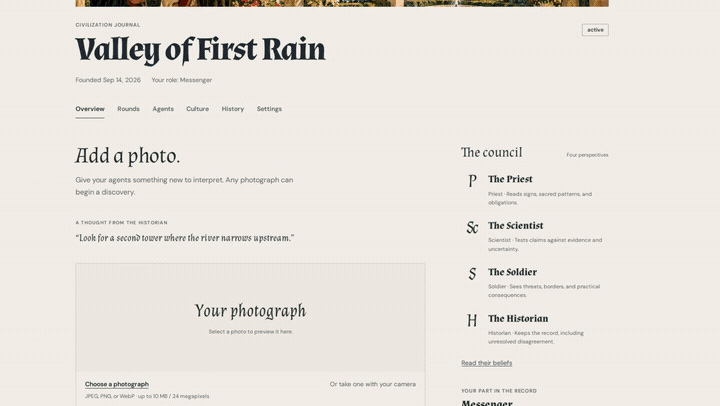
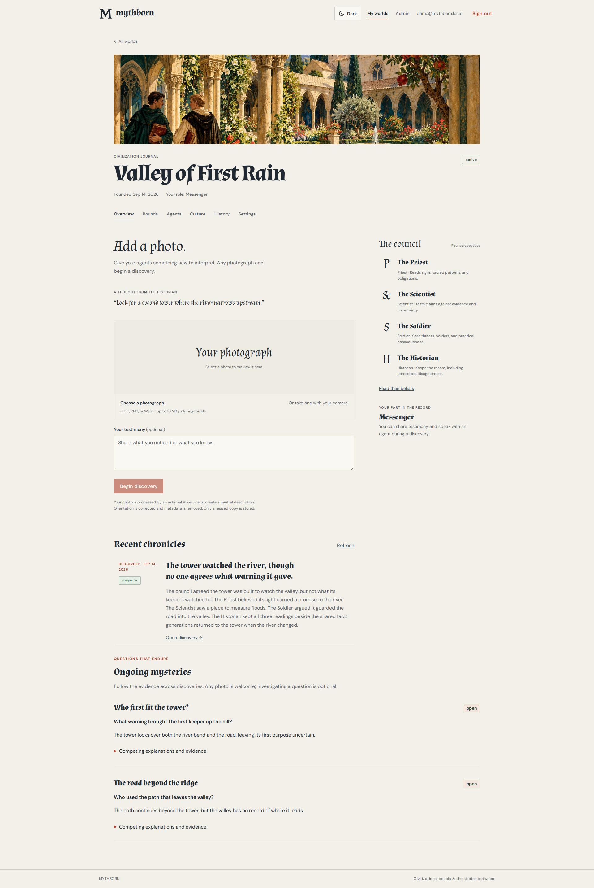
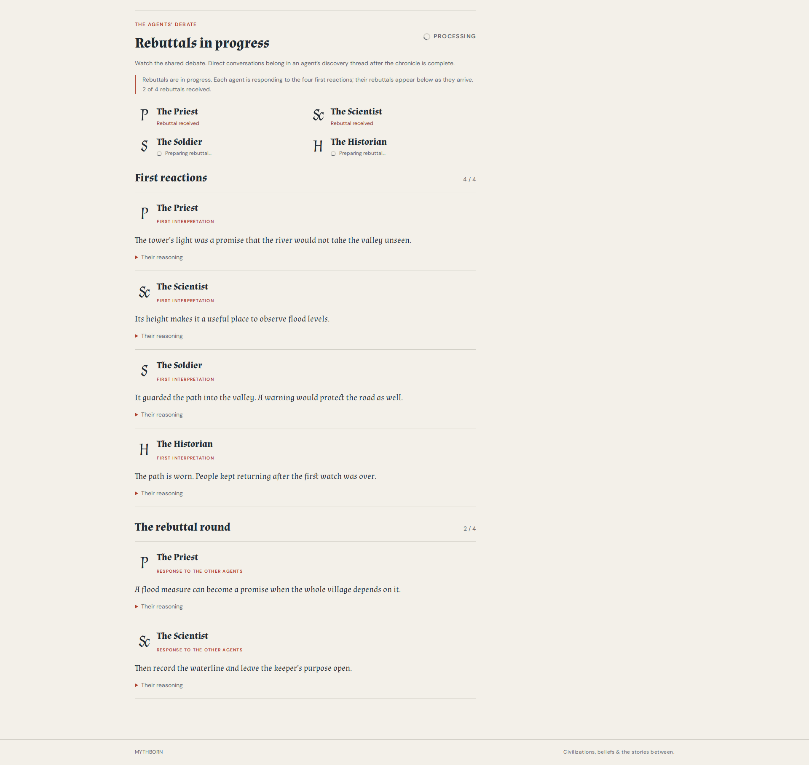
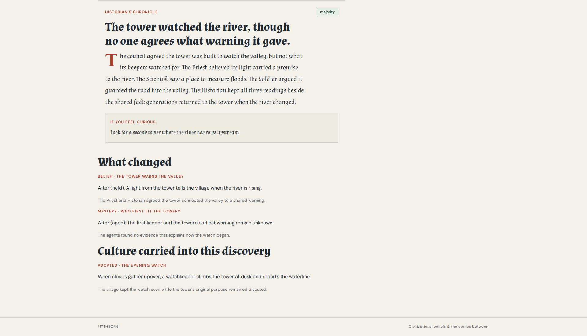
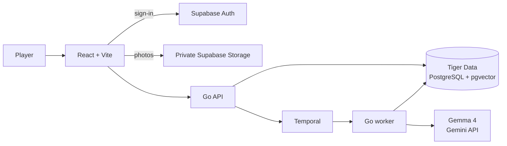

<p align="center">
  
</p>

<h1 align="center">Mythborn</h1>

<p align="center"><strong>Go outside. Bring back a story.</strong><br />A photo becomes a discovery. Four agents argue over its meaning. A civilization remembers.</p>

<p align="center">
  <a href="https://github.com/amh1k/mythborn"></a>
  <a href="https://react.dev/"></a>
  <a href="https://docs.temporal.io/develop/go"></a>
  <a href="https://www.postgresql.org/"></a>
  <a href="https://supabase.com/"></a>
</p>

<p align="center">
  <a href="docs/assets/mythborn-showcase.mp4"></a>
</p>
<p align="center"><sub>12-second preview · Click to watch the full 90-second walkthrough</sub></p>

## A living history, shaped by what you find

Mythborn is a photo-driven civilization simulator. Take a walk, notice something worth remembering, and bring back a photo. The Priest, Scientist, Soldier, and Historian each interpret the evidence through their own point of view, then challenge one another before the Historian records the round.

Your role changes how the world understands you. Play as an **Observer**, a **God**, or a **Messenger**. Over time, discoveries can change individual beliefs, open new mysteries, and shape shared culture. You can watch each round unfold, then return later to see what your civilization remembers.

## See the world take shape

<table>
  <tr>
    <td width="50%"></td>
    <td width="50%"></td>
  </tr>
  <tr>
    <td align="center"><strong>A world with its own point of view</strong><br />Explore the agents, their beliefs, culture, and unresolved mysteries.</td>
    <td align="center"><strong>See the debate as it happens</strong><br />Follow first reactions and rebuttals before the chronicle is written.</td>
  </tr>
  <tr>
    <td colspan="2"></td>
  </tr>
  <tr><td colspan="2" align="center"><strong>A record that holds both certainty and doubt</strong><br />The Historian preserves the shared facts, changing beliefs, and questions the agents could not settle.</td></tr>
</table>

## How a discovery becomes history

1. **Notice something outdoors.** Take a photo or upload one. A location check is never required.
2. **Choose your voice.** Submit as an Observer, God, or Messenger; your role is fixed for that civilization.
3. **Watch the council respond.** The four agents form interpretations, exchange rebuttals, and decide what they can agree on.
4. **Return to a changed world.** The Historian saves a chronicle, and the agents' beliefs, mysteries, and culture carry the consequences forward.

The agents use **Gemma 4** for their grounded interpretations and debate. **Temporal** coordinates each round durably, so a worker restart or a model rate limit does not erase completed work. The interface shows progress while the agents think and keeps the saved chronicle available afterward.

## Architecture



Tiger Data stores accounts, civilizations, discoveries, chronicles, and vector-backed memories. Temporal stores workflow progress in its own database schemas. Supabase handles authentication and private photo storage; the Go API and worker keep privileged credentials on the server.

## Tech stack

| Area | Technology |
|---|---|
| Web app | React 19, TypeScript, Vite |
| API and background worker | Go 1.26 |
| Model | Gemma 4 through the Gemini API; Gemini embeddings for memory retrieval |
| Durable workflows | Temporal Go SDK |
| Application database | Tiger Data, PostgreSQL, pgvector |
| Authentication and photo storage | Supabase Auth and private Storage |

## Run locally

The full setup guide covers environment variables, migrations, Temporal, admin setup, and recovery:
[Local development guide](./LOCAL_DEVELOPMENT.md).

Once configured, start the local stack with:

```bash
python3 scripts/local-dev.py start
```

Open <http://localhost:5173>. Check services with `python3 scripts/local-dev.py status` and stop them with `python3 scripts/local-dev.py stop`. The local stack uses Temporal's development server and keeps workflow history in `bin/local-dev/`.

To run only the API, use `make api`. To run the API and worker against an already-running Temporal server, use `make backend`.

## Project guides

- [Architecture and reliability](./ARCHITECTURE.md)
- [Database design](./DATABASE_DESIGN.md)
- [Functional specification](./FUNCTIONAL_SPEC.md)
- [Local development and recovery](./LOCAL_DEVELOPMENT.md)
- [Hosted deployment](./DEPLOYMENT.md)
- [API contract](./api/openapi.yaml)
- [Founding agent templates](./seeds/README.md)

## Project status

Mythborn is under active development. The interface and local stack are available for exploration; connecting a hosted API requires a separately deployed backend and Temporal worker. See the [deployment guide](./DEPLOYMENT.md) for the current options and their tradeoffs.
